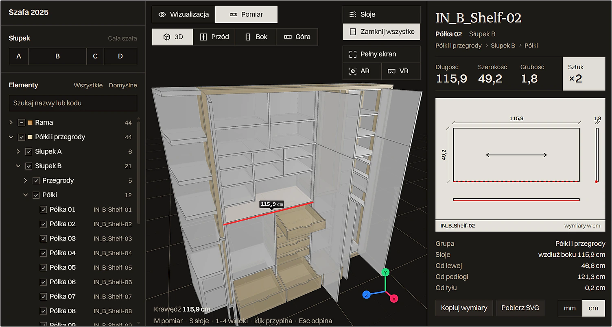

# Wardrobe 2025



A modern 3D wardrobe visualization application built with React Three Fiber, featuring interactive 3D models, VR/AR support, and responsive design.

[**Live Demo**](https://drygiel.github.io/wardrobe/)

## 🚀 Features

### Core Functionality
- **Interactive 3D Wardrobe Model**: Fully interactive wardrobe with openable doors, drawers, and compartments
- **Multiple View Modes**: Switch between texture, wireframe, and orthographic views
- **Responsive Design**: Optimized for desktop, tablet, and mobile devices
- **VR/AR Support**: Full VR and AR capabilities with proper head tracking
- **Measure Editor** (`/pomiar`): Tree of all parts, edge measuring, part drawings with grain direction, SVG download, mm/cm units
- **Frame and Electrics Pages** (`/rama`, `/elektryka`): Frame build with cut plan, wiring with live circuit and drill sheet
- **Image Gallery** (`/galeria`): Renders of the finished wardrobe

### Technical Features
- **Real-time 3D Rendering**: High-performance WebGL rendering with shadows
- **Smooth Animations**: Tweened camera transitions and interactive animations
- **Layer Management**: Multi-layer rendering system for complex scenes
- **Grid System**: Optional grid overlay for spatial reference
- **Gizmo Controls**: 3D navigation helpers for better user experience

## 🛠️ Tech Stack

### Frontend
- **React 19** - Modern React with latest features
- **Vite 8** - Dev server and bundler
- **React Router 7** - Client-side routes: `/`, `/okucia`, `/rama`, `/elektryka`, `/plan`, `/pomiar`, `/galeria`; the menu, footer and next-page links read them from `app/site.ts`
- **TypeScript** - Type-safe development
- **Sass** - CSS preprocessing with modules

### 3D Graphics
- **Three.js** - Core 3D graphics library
- **React Three Fiber** - React renderer for Three.js
- **React Three Drei** - Useful helpers and abstractions
- **React Three XR** - VR/AR support
- **Tween.js** - Smooth animations

### UI Components
- **React Image Gallery** - Photo gallery functionality

### Development Tools
- **ESLint** - Code linting and formatting
- **Prettier** - Code formatting
- **Yarn** - Package management

## 📁 Project Structure

```
app/
├── components/            # 3D scene, models, measuring
│   ├── Scene.tsx          # Main 3D scene with camera controls
│   ├── Wardrobe.tsx       # Interactive wardrobe model
│   ├── Mesh.tsx           # Custom mesh component with measurement
│   └── LineHint.tsx       # Measurement line hints
├── contexts/
│   └── AppContext.tsx     # Global state management
├── editor/                # Measure editor (/pomiar)
├── electric/              # Electrics page sections (/elektryka)
├── sections/              # Sections of the content pages
├── xr/                    # VR/AR stage, menu, wall placement
├── hooks/
│   ├── useEventListener.tsx
│   └── useReveal.ts
├── assets.ts              # Model, atlas and image paths
├── main.tsx               # Entry and route table
├── szafa.tsx, rama.tsx, elektryka.tsx, editor.tsx, galeria.tsx  # Route pages
└── global.scss            # Global styles
scripts/                   # Blender bake/export and asset processing
tests/                     # Unit tests (yarn test)
```

## 🎮 Controls & Navigation

### Desktop Controls
- **Mouse**: Orbit around the wardrobe
- **Scroll**: Zoom in/out
- **Click**: Interact with doors and drawers
- **Keyboard** (measure editor): `M` measure mode, `S` grain, `1`-`4` views, `Esc` unpin the part

### Mobile Controls
- **Touch**: Pan and zoom gestures
- **Tap**: Interact with wardrobe elements
- **Swipe**: Navigate image gallery

### VR/AR Controls
- **Head Movement**: Natural head tracking
- **Grip (hold)**: Move the wardrobe with the hand, turn it with the wrist; the thumbstick carries it further. It snaps to walls and corners detected by the headset
- **Trigger**: Menu above the left controller, doors and drawers; in measure mode point at an edge to read its length, press to pin the part

## 🔧 Development

### Prerequisites
- Node.js 20.19+ or 22.12+ (CI uses 24)
- Yarn package manager

### Installation
```bash
# Clone the repository
git clone <repository-url>
cd wardrobe

# Install dependencies
yarn install

# Start development server
yarn dev
```

### Available Scripts
```bash
yarn dev          # Start development server (port 4000)
yarn build         # Build for production
yarn preview       # Preview production build (port 4001)
yarn lint          # Run ESLint
yarn tscheck       # Type-check without emitting
yarn test          # Run unit tests
yarn bake          # Bake textures in Blender, then build the atlas
yarn atlas         # Build the texture atlas only
yarn export:model  # Export GLB models from Blender
yarn transform     # Process exported models
```

### Deployment
Every push to `main` builds the site and publishes it to GitHub Pages (`.github/workflows/deploy.yml`).

### Environment Variables
```env
BASE_PATH=/your-base-path/  # Optional base path (Vite `base`)
BLENDER=path/to/blender.exe  # `yarn bake` / `yarn export:model` (see .env.sample)
BLEND_FILE=../Szafa4.blend   # Scene the Blender scripts run on
```

## 🎨 Customization

### Adding New Wardrobe Models
1. Place GLB files in `/public/models/`
2. Update the model path in `app/assets.ts`
3. Adjust materials and animations as needed

### Styling
- Component styles: `*.module.scss` files
- Global styles: `app/global.scss`
- Main responsive breakpoint: 767px (the measure editor uses 1179px and 759px)

### State Management
The application uses React Context for state management:
- `wireframe`: Toggle wireframe mode
- `orthographic`: Switch camera projection
- `grid`: Show/hide grid overlay
- `hidden`, `hiddenParts`: Hidden part groups and single parts (`hideFronts` is derived from `hidden`)
- `grain`: Show grain direction
- `unit`: Measurement unit (mm/cm)
- `layer`: Current camera layer
- `view`: Camera view state
- `gizmo`: Show navigation gizmo

## 📱 Responsive Design

### Breakpoints
- **Desktop**: ≥ 768px - Full layout
- **Mobile**: ≤ 767px - Single-column sections
- **Measure editor**: Rearranges panels at ≤ 1179px and ≤ 759px

### Mobile Optimizations
- Touch-friendly controls
- Responsive typography
- Optimized 3D performance
- Full-screen VR support

## 🚧 Roadmap

### Must Have
- [x] Texture/solid/wireframe mode
- [ ] Camera animations on site scroll
- [ ] Project stages navigation
- [ ] Wardrobe-only renders
- [ ] Full room renders

### Nice to Have
- [ ] HDR environment mapping
- [ ] Interior lighting system
- [ ] Disassembly animations
- [ ] Advanced measurement tools

### Optional
- [ ] Smooth scroll integration
- [ ] Video rendering capabilities
- [ ] Advanced vertex measurement tools

## 🤝 Contributing

1. Fork the repository
2. Create a feature branch
3. Make your changes
4. Test thoroughly
5. Submit a pull request

## 📄 License

This project is private and proprietary.

## 🔗 Links

- [Live Demo](https://drygiel.github.io/wardrobe/)
- [Three.js Documentation](https://threejs.org/docs/)
- [React Three Fiber](https://docs.pmnd.rs/react-three-fiber)
- [React Three Drei](https://github.com/pmndrs/drei)

